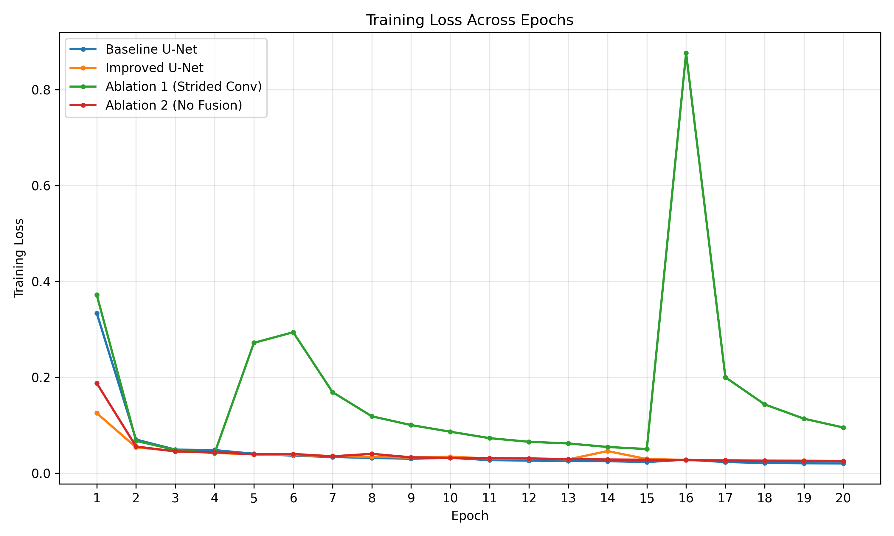
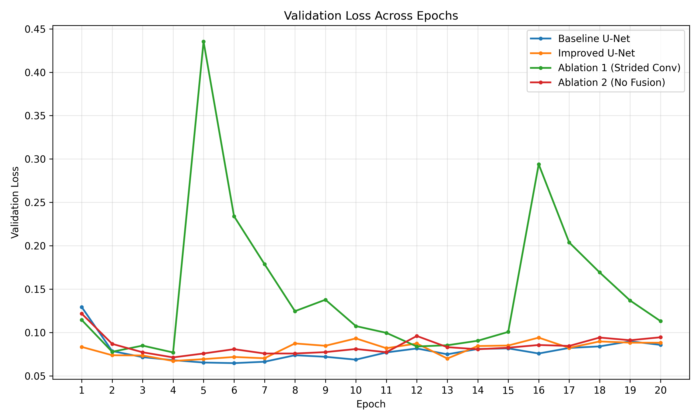
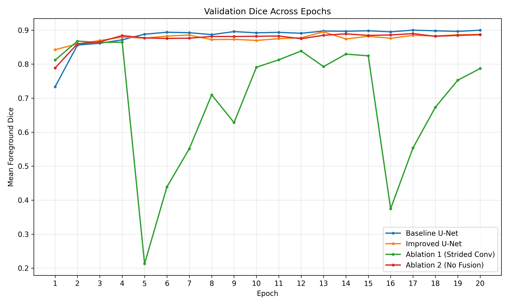
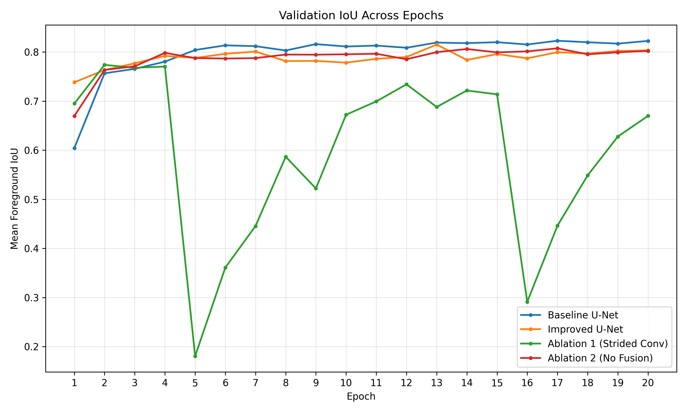
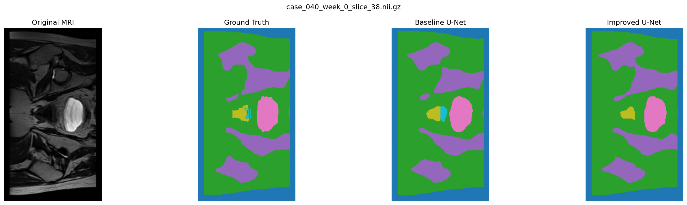
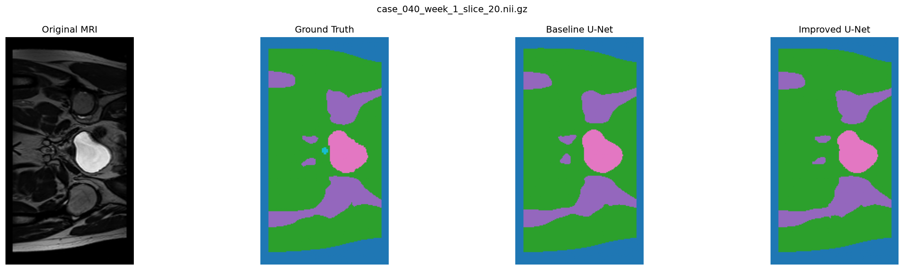
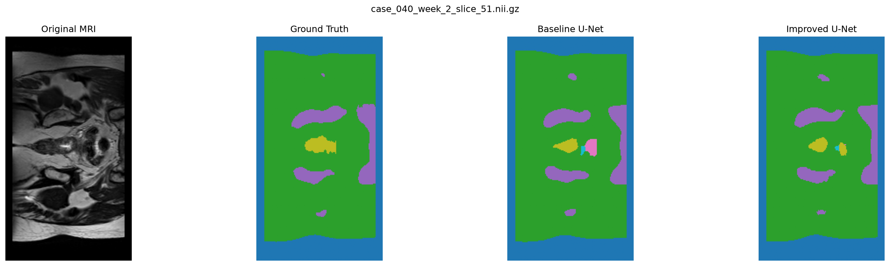
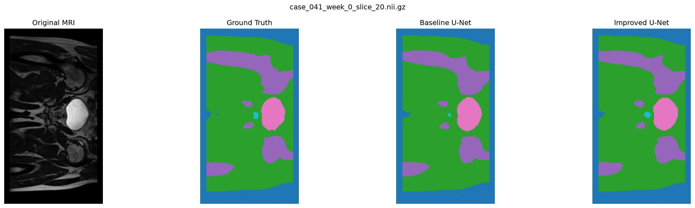
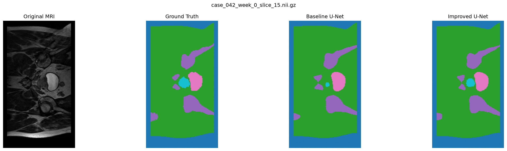

# HipMRI Segmentation Using an Improved U-Net

## 1. Introduction

Medical image segmentation involves identifying and classifying anatomical regions within medical images. In prostate radiotherapy planning, accurate segmentation is important for identifying anatomical structures and their boundaries, as errors may affect treatment planning and the reliability of subsequent analysis.

U-Net is a widely used convolutional neural network architecture for medical image segmentation. Although conventional 2D U-Net models can achieve high segmentation accuracy, their predictions may still contain boundary inaccuracies, missed structures and false-positive regions. Furthermore, evaluating segmentation performance using only overall metrics such as Dice similarity can conceal errors affecting individual anatomical classes.

This project investigates an **Improved 2D U-Net architecture** for multi-class segmentation of HipMRI images. A standard 2D U-Net is implemented as the baseline, while the improved architecture incorporates residual context modules, learnable downsampling, localisation modules and multi-scale prediction fusion.

The primary objective is to investigate whether these architectural modifications provide meaningful improvements in segmentation performance and boundary precision compared with the standard U-Net, while considering their computational requirements. Both architectures are evaluated using the same held-out test dataset, with comparisons based on Dice similarity, Intersection over Union (IoU), boundary precision, model complexity, GPU memory consumption and inference time.

In addition to quantitative evaluation, the project examines individual segmentation failures to identify limitations that may not be apparent from aggregate performance metrics. Based on the experimental findings, the project assesses whether the Improved U-Net offers a suitable balance between segmentation accuracy, boundary reliability and computational efficiency for further development as an annotation assistant, while identifying the limitations that require additional investigation.

## 2. Project Structure

The project is organised into separate modules for dataset preparation, model implementation, training, prediction, evaluation and failure-case analysis. The baseline U-Net implementation is maintained in a separate directory to support comparisons with the Improved U-Net.

```text
hipmri-improved-unet/
│
├── README.md
├── dataset.py
├── modules.py
├── train.py
├── predict.py
├── test.py
├── utils.py
├── visual_failure.py
│
├── baseline_unet/
│   ├── modules.py
│   ├── train.py
│   └── test.py
│
└── results/
    └── figures/
```

**File descriptions:**

- `README.md` — Project documentation, experimental results and engineering recommendations.
- `dataset.py` — Loads HipMRI images and segmentation masks and applies preprocessing.
- `modules.py` — Defines the Improved U-Net architecture and its components.
- `train.py` — Implements model training and validation.
- `predict.py` — Loads trained models, generates segmentation predictions and visualises baseline comparisons.
- `test.py` — Evaluates the Improved U-Net using segmentation and computational metrics.
- `utils.py` — Provides shared evaluation utilities and segmentation metrics.
- `visual_failure.py` — Generates visualisations for analysing segmentation failures.
- `baseline_unet/modules.py` — Defines the baseline U-Net architecture.
- `baseline_unet/train.py` — Implements baseline U-Net training and validation.
- `baseline_unet/test.py` — Evaluates the baseline U-Net on the same test dataset.
- `results/figures/` — Contains training curves and selected segmentation comparison figures.

## 3. Dataset and Preprocessing

### 3.1 Dataset Description

The HipMRI dataset contains grayscale MRI slices stored in NIfTI (.nii.gz) format, with two original spatial dimensions: 256 × 128 and 256 × 144 pixels. Of the 12,660 slices, 12,600 have dimensions of 256 × 128, while the remaining 60 have dimensions of 256 × 144.

To ensure consistent input dimensions during training and evaluation, the smaller slices were padded to 256 × 144. The corresponding segmentation masks were padded consistently to preserve spatial alignment between MRI images and their ground-truth annotations.

Each segmentation mask contains integer labels ranging from 0 to 5, representing six segmentation classes, including the background.


### 3.2 Dataset Splitting

The dataset is divided into training, validation and testing subsets. Patient-level separation is used to prevent MRI scans from the same patient appearing in multiple subsets and to avoid data leakage.

| Dataset Property | Training | Validation | Testing |
|---|---:|---:|---:|
| Number of MRI slices | 11,460 | 660 | 540 |
| Number of patients | 31 | 4 | 3 |

The dataset contains **12,660 MRI slices from 38 patients** across the three subsets.

Patient-level splitting is particularly important because the dataset contains longitudinal scans. Images collected from the same patient across different weeks may share anatomical characteristics, potentially introducing data leakage if distributed across training and evaluation subsets.

Patient identifiers were checked across the three subsets to verify that no patient appeared in more than one split. This ensures that the held-out test set evaluates model performance on patients not encountered during training.

### 3.3 Class Distribution and Imbalance

An analysis of the ground-truth segmentation masks revealed substantial class imbalance across the HipMRI dataset. While Classes 0 and 1 are present in every slice, Classes 4 and 5 occur considerably less frequently.

In the training set, Class 4 appears in only 35.39% of slices, while Class 5 appears in 36.23%. Similar distributions are observed in the validation and testing subsets, indicating that the imbalance persists across the dataset.

The pixel distribution is also uneven. Classes 1 and 2 occupy substantially more pixels than Classes 4 and 5, which represent comparatively small segmentation regions.

This imbalance presents a challenge for multi-class segmentation because models may learn more effectively from frequently represented classes. Consequently, overall segmentation metrics may conceal poorer performance on underrepresented structures.

To investigate this limitation, the project evaluates per-class Dice, IoU and boundary precision rather than relying exclusively on aggregate segmentation accuracy.

### 3.4 Data Preparation

Using the `nibabel` library, the MRI images and their corresponding segmentation masks are loaded. Each image is paired with its ground-truth mask by matching their filenames. This is done by replacing the `case_` prefix with `seg_`.

The preprocessing pipeline consists of the following steps:

**1. Intensity Normalisation** – Min-max normalisation is applied independently to each MRI slice, scaling intensity values to [0, 1]. Constant-intensity slices are replaced with zero-filled arrays to avoid division by zero.

**2. Spatial Padding** – Eight columns of zeros are added to both sides of the smaller images to standardise their dimensions from 256 × 128 to 256 × 144. Identical padding is applied to the segmentation masks using background label 0 to preserve spatial alignment.

**3. Tensor Conversion** – MRI images are converted into PyTorch tensors of shape `[1, 256, 144]`. Segmentation masks are converted into integer tensors of shape `[256, 144]`, preserving class labels 0–5 for use with multi-class cross-entropy loss.

## 4. Model Architecture

This project implements a 2D Improved U-Net architecture inspired by Isensee et al. (2018) [2] for multi-class segmentation of HipMRI images. The model adapts the reference architecture for 2D MRI slices while retaining its main structural components.

A baseline U-Net based on Ronneberger et al. (2015) [1] is implemented for comparison. The comparative study investigates whether the additional architectural components of the Improved U-Net provide meaningful improvements in segmentation accuracy, boundary reliability and computational efficiency.

### 4.1 Baseline U-Net

The baseline U-Net follows an encoder–decoder architecture with skip connections.

The encoder uses two consecutive 3 × 3 convolutional layers with ReLU activation at each level, followed by max pooling to progressively reduce spatial dimensions and extract features.

The decoder uses bilinear interpolation to upsample feature maps, which are concatenated with corresponding encoder features through skip connections. These combined features are processed using convolutional blocks to reconstruct spatial details.

Finally, a 1 × 1 convolution produces six output channels corresponding to the segmentation classes.

The baseline provides a reference for assessing whether the additional architectural complexity of the Improved U-Net delivers practical benefits.

### 4.2 Improved U-Net

The Improved U-Net is implemented as a 2D adaptation of the architecture proposed by Isensee et al. (2018) [2]. It retains the U-Net encoder–decoder structure while introducing residual context modules, strided convolutions, localisation modules and multi-resolution prediction fusion.

The architecture consists of the following components:

1. Encoder: Five encoding levels with 16, 32, 64, 128 and 256 feature channels. Residual context modules use convolutional layers, instance normalisation, LeakyReLU activation and dropout to extract features. Strided convolutions progressively reduce spatial resolution.

2. Decoder: Four decoding stages use nearest-neighbour upsampling followed by convolution. Features from the encoder are concatenated through skip connections and refined using localisation modules to reconstruct spatial information.

3. Multi-resolution Prediction Fusion: Segmentation predictions are generated at three decoder resolutions using 1 × 1 convolutions. Lower-resolution predictions are progressively upsampled and combined through element-wise addition to produce the final six-class segmentation logits.

## img 

The architecture is designed to incorporate contextual information from multiple spatial resolutions while maintaining a relatively lightweight model. Its effectiveness is assessed through segmentation accuracy, boundary precision and computational efficiency rather than architectural complexity alone.

### 4.3 Architecture Comparison

The following table summarises the main architectural differences between the baseline U-Net and the Improved U-Net.

| Component | Baseline U-Net | Improved U-Net |
|---|---|---|
| Architecture | 2D encoder–decoder | 2D encoder–decoder with residual context modules |
| Encoder | Double convolution blocks | Residual context modules |
| Downsampling | Max pooling | 3 × 3 strided convolutions |
| Activation | ReLU | LeakyReLU |
| Normalisation | No explicit normalisation | Instance normalisation |
| Dropout | Not implemented | Dropout (0.3) |
| Upsampling | Bilinear interpolation | Nearest-neighbour interpolation followed by convolution |
| Skip Connections | Encoder–decoder concatenation | Encoder–decoder concatenation |
| Decoder | Double convolution blocks | Localisation modules |
| Multi-resolution Prediction Fusion | Not implemented | Implemented |
| Output | Six-class segmentation logits | Six-class segmentation logits |

The models are primarily compared based on their architectural differences and how these differences influence their performance. Their effects on segmentation accuracy, boundary reliability and computational efficiency are examined in the experimental results.

## 5. Feasibility Review — HipMRI Improved U-Net

**Project:** Prostate Radiotherapy Planning | **Difficulty:** Normal | **Model:** 2D Improved U-Net

### 5.1 User Need, Scope and Acceptance Criteria

The prototype aims to assist imaging specialists by generating segmentation contours for prostate radiotherapy planning, subject to expert review. The main engineering question is whether the Improved U-Net offers meaningful improvements in segmentation accuracy and boundary reliability over the baseline at a reasonable computational cost.

**Acceptance Criteria:**

- Achieve prostate-specific test Dice ≥ 0.75, with an additional mean foreground Dice target of ≥ 0.90.
- Compare both models using per-class Dice, IoU and boundary precision on the same held-out test dataset.
- Analyse 3–5 difficult segmentation cases using ground-truth masks, predictions and error visualisations.
- Measure model complexity, peak GPU memory consumption and inference time per slice.

### 5.2 Model Choice and Course Concepts

The HipMRI dataset contains 11,460 training, 660 validation and 540 test slices, separated at the patient level.

The standard 2D U-Net serves as the baseline, while the Improved U-Net incorporates residual context modules, instance normalisation, learnable downsampling, localisation modules and multi-resolution prediction fusion, inspired by Isensee et al. (2018) [2].

Relevant concepts include CNNs, encoder–decoder segmentation, residual learning and regularisation. The 2D approach is computationally efficient but lacks explicit inter-slice context.

### 5.3 Preliminary Feasibility Evidence

Initial dataset inspection identified inconsistent image dimensions (256 × 128 and 256 × 144), resolved using symmetric zero-padding for images and masks. Patient-level separation between the training, validation and test sets was verified.

Both models were successfully implemented and trained. The Improved U-Net completed 20 epochs on Rangpur in **27 minutes and 38 seconds**, achieving a minimum validation loss of **0.0671 at epoch 4** and a mean foreground validation Dice of **0.8795**.

These findings established technical feasibility, but validation performance alone could not confirm the prostate-specific test Dice requirement or improvements over the baseline.

### 5.4 Risks, Computational Budget and Fallback

**Risks:** Class imbalance, missed anatomical regions, boundary inaccuracies and lack of explicit 3D context.

**Computational Budget:** Approximately 28 minutes per 20-epoch Improved U-Net training run, subject to GPU availability.

**Fallback:** Retain the baseline U-Net if the Improved U-Net does not provide sufficient segmentation or boundary improvements to justify its computational cost.

### 5.5 Experimental Investigation Plan

The following investigations were selected to assess the Improved U-Net:

- **Baseline Comparison:** Compare mean foreground Dice, IoU, boundary precision and per-class performance.
- **Architectural Ablation:** Replace baseline max pooling with strided convolutions to investigate learnable downsampling.
- **Failure Analysis:** Examine difficult cases for missed regions, false positives and boundary inaccuracies.
- **Computational Efficiency:** Compare trainable parameters, peak GPU memory and inference time per slice.
- **Engineering Assessment:** Assess segmentation reliability, computational trade-offs and requirements for practical deployment.

The implementation, results, observations and inferences are presented in subsequent sections.

## 6. Experimental Setup and Evaluation Metrics

### 6.1 Training Configuration

The baseline U-Net and Improved U-Net were implemented using PyTorch and trained for 20 epochs on the Rangpur HPC cluster using GPU acceleration.

Both models used Cross-Entropy Loss for multi-class segmentation. The validation dataset was used to monitor training and select checkpoints, while the held-out test dataset was reserved for final evaluation.

**Checkpoint Selection:** The checkpoint with the lowest validation loss was selected for each model rather than the final epoch. This criterion was used to favour generalisation while preventing test performance from influencing model selection.

### 6.2 Evaluation Procedure

Both architectures were evaluated on the same held-out test dataset, consisting of 540 MRI slices from three patients.

The evaluation considered overall segmentation performance, class-specific performance and computational efficiency to identify improvements and potential trade-offs.

The strided-convolution ablation model was evaluated using the same test dataset and metrics to investigate the contribution of learnable downsampling.

### 6.3 Evaluation Metrics

The following metrics were used to assess segmentation quality and computational efficiency.

| Metric | Purpose |
|---|---|
| **Dice Similarity Coefficient (DSC)** | Measures overlap between predicted and ground-truth regions. |
| **Intersection over Union (IoU)** | Measures overlap relative to the union of predicted and ground-truth regions. |
| **Boundary Precision (2-pixel tolerance)** | Measures the proportion of predicted boundary pixels within two pixels of the ground-truth boundary. |
| **Per-Class Dice and Boundary Precision** | Identifies performance differences across segmentation classes. |
| **Trainable Parameters** | Measures model size in terms of trainable parameters. |
| **Peak GPU Memory** | Measures GPU memory consumption during benchmarked evaluation. |
| **Inference Time** | Measures prediction latency per MRI slice. |

Mean foreground segmentation metrics exclude the background class (Class 0).

### 6.4 Experimental Comparisons

Three model configurations were evaluated:

1. **Baseline U-Net:** Standard 2D U-Net using max-pooling downsampling.
2. **Strided-Convolution Ablation:** Modified baseline U-Net with strided convolutions replacing max pooling.
3. **Improved U-Net:** 2D architecture incorporating residual context modules, strided downsampling, localisation modules and multi-resolution prediction fusion.

These comparisons assess whether the Improved U-Net's architectural changes provide sufficient improvements in segmentation quality and boundary reliability to justify their computational costs, helping determine its suitability for practical use.

## 7. Experimental Results and Analysis

This section evaluates whether the Improved U-Net provides sufficient improvements in segmentation quality, boundary reliability and computational efficiency to justify its selection over the baseline.

### Training and Validation Behaviour

All four models were trained for **20 epochs**, with training loss, validation loss, Dice and IoU recorded to assess convergence and training stability.

The key observations from the training curves are:

- **Baseline U-Net:** Demonstrated stable convergence and generally achieved the highest validation performance, reaching approximately **0.90 Dice and 0.82 IoU**.
- **Improved U-Net and Ablation 2:** Both showed relatively stable convergence, with validation Dice generally ranging between **0.87 and 0.89** after the initial epochs.
- **Ablation 1 (Strided Convolutions):** Showed significant instability. Validation Dice dropped from **0.8645 to 0.2129** at epoch 5, with another sharp decline to approximately **0.38** at epoch 16. Although performance recovered, it finished with a validation Dice of approximately **0.79**.

Despite the baseline's stronger validation performance, the **Improved U-Net achieved better results on the held-out test set**, with a Dice of **0.9046 versus 0.8995** and IoU of **0.8333 versus 0.8260**. It also used **59.4% fewer parameters, 53.3% less peak GPU memory and 46.9% less inference time per slice**.

**Engineering implication:** The Improved U-Net offers a better balance of test performance and computational efficiency. However, the improvements are modest, and additional training runs and patient-level evaluation are recommended to confirm reliability before deployment.

#### Training and Validation Performance

| Training Loss | Validation Loss |
|:---:|:---:|
|  |  |
| **Validation Dice** | **Validation IoU** |
|  |  |

*Figure 1. Training and validation performance across 20 epochs for the baseline U-Net, Improved U-Net, and two ablation configurations.*


### 7.1 Baseline U-Net vs Improved U-Net

**Hypothesis:** The Improved U-Net is expected to provide better segmentation performance and computational efficiency than the baseline U-Net through its residual context modules, strided convolution downsampling and multi-resolution prediction fusion.

**Implementation:** Both models were evaluated on the same patient-independent test split using foreground Dice, IoU, boundary precision (2-pixel tolerance) and computational efficiency metrics.

| Metric | Baseline U-Net | Improved U-Net |
|---|---:|---:|
| Mean Foreground Dice | 0.8995 | **0.9046** |
| Mean Foreground IoU | 0.8260 | **0.8333** |
| Mean Boundary Precision | 0.8196 | **0.8254** |
| Trainable Parameters | 7,846,246 | **3,184,850** |
| Peak GPU Memory | 712.10 MB | **332.57 MB** |
| Average Inference Time | 0.8226 ms/slice | **0.4371 ms/slice** |

**Observation:**
- The Improved U-Net achieved slightly better segmentation performance, with Dice increasing from **0.8995 to 0.9046**, IoU from **0.8260 to 0.8333**, and boundary precision from **0.8196 to 0.8254**.
- Computational efficiency improved significantly, with **59.4% fewer parameters, 53.3% less peak GPU memory and 46.9% lower inference time per slice**.
- However, improvements were not consistent across all classes. Class 5 Dice increased from **0.7868 to 0.8309**, while Class 4 Dice decreased from **0.8322 to 0.8106**.

**Inference:** The Improved U-Net offers a better balance between segmentation performance and computational efficiency, making it the stronger candidate for further development. However, the relatively small improvements in overall segmentation quality and differences across classes require further investigation before clinical deployment.

### 7.2 Ablation 1: Strided Convolution Downsampling

**Hypothesis:** Replacing max pooling with strided convolutions may improve segmentation performance by allowing the model to learn how features are downsampled instead of using fixed pooling operations.

**Implementation:** The max-pooling layers in the baseline U-Net were replaced with strided convolutions, while the remaining architecture was kept unchanged. The model was trained for 20 epochs and evaluated using the same patient-independent test set.

| Metric | Baseline U-Net | Ablation 1 |
|---|---:|---:|
| Mean Foreground Dice | 0.8995 | **0.9003** |
| Mean Foreground IoU | 0.8260 | **0.8269** |
| Mean Boundary Precision (2 px) | 0.8196 | **0.8235** |
| Trainable Parameters | **7,846,246** | 8,194,886 |
| Peak GPU Memory | **712.10 MB** | 713.43 MB |
| Average Inference Time | **0.8226 ms/slice** | 0.8470 ms/slice |

**Observation:**
- Ablation 1 achieved slightly better Dice (+0.0008), IoU (+0.0009) and boundary precision (+0.0039). However, these improvements were very small.
- The number of trainable parameters increased by approximately **4.4%**, while inference time increased by **3.0%**, making the model slightly more computationally expensive.
- The training curves also showed instability, particularly at epochs 5 and 16, where validation Dice dropped significantly before recovering.

**Inference:** Although strided convolutions provided a small improvement in segmentation performance, the difference was not substantial enough to justify the additional parameters and inference time. The training fluctuations also raise concerns about the consistency of this approach. Therefore, **replacing max pooling with strided convolutions alone is not recommended**, as the baseline achieves nearly identical results with fewer computational resources and more stable training behaviour in this experiment.

### 7.3 Ablation 2: Removing Multi-Resolution Prediction Fusion

**Hypothesis:** Combining predictions from multiple decoder resolutions may improve segmentation performance by incorporating information from different spatial scales. Removing this feature may reduce segmentation accuracy, particularly for smaller anatomical structures.

**Implementation:** Multi-resolution prediction fusion was removed from the Improved U-Net, allowing the model to generate predictions using only the final decoder output. The remaining architecture was kept unchanged. The model was trained for 20 epochs and evaluated on the same patient-independent test set.

| Metric | Improved U-Net | Ablation 2 |
|---|---:|---:|
| Mean Foreground Dice | **0.9046** | 0.9026 |
| Mean Foreground IoU | **0.8333** | 0.8305 |
| Mean Boundary Precision (2 px) | 0.8254 | **0.8314** |
| Trainable Parameters | 3,184,850 | **3,184,262** |
| Peak GPU Memory | 332.57 MB | **332.56 MB** |
| Average Inference Time | 0.4371 ms/slice | **0.4305 ms/slice** |

**Observation:**

- Removing multi-resolution prediction fusion resulted in a small reduction in segmentation performance, with Dice decreasing from **0.9046 to 0.9026** and IoU from **0.8333 to 0.8305**.
- Boundary precision improved slightly from **0.8254 to 0.8314**, suggesting that removing fusion did not negatively affect every evaluation metric.
- The number of trainable parameters decreased by only **588**, while GPU memory usage and inference time remained almost identical.
- Class-level performance also varied. Class 4 Dice increased from **0.8106 to 0.8252**, while Class 5 Dice decreased from **0.8309 to 0.8055**.

**Inference:** Multi-resolution prediction fusion provided a small improvement in overall Dice and IoU, without substantially increasing computational requirements. Although Ablation 2 achieved slightly better boundary precision, the improvement was not sufficient to outweigh the reduction in overall segmentation overlap. Therefore, **retaining multi-resolution prediction fusion is preferred**, as it provides slightly better overall segmentation performance with almost no additional computational cost.

 ## 8. Failure Case Analysis

Although the Improved U-Net achieved better overall segmentation performance, individual test slices were examined to identify segmentation errors and understand where the architectural modifications provided improvements.

Five representative cases were selected to investigate missed segmentations, false-positive predictions and differences between the baseline and Improved U-Net.

### 8.1 Missed Segmentations

**Case 1: `case_040_week_0_slice_38`**



**Observation:**
- The baseline U-Net partially identified the Class 5 region, achieving a Dice score of **0.3614**, while the Improved U-Net failed to identify it (**Dice = 0**).
- This demonstrates that the Improved U-Net does not consistently outperform the baseline across every individual slice.

**Inference:** Although the Improved U-Net achieved better overall performance, it can still miss certain small labelled regions that the baseline partially detects. This limitation should be considered when assessing segmentation reliability.

**Case 2: `case_040_week_1_slice_20`**



**Observation:**
- Both models failed to detect a small Class 5 region present in the ground truth, resulting in a Dice score of **0** for both models.
- The models were able to segment the surrounding larger regions more consistently.

**Inference:** Both architectures face difficulties identifying certain small labelled regions. This suggests that further investigation into class representation and small-region segmentation may be beneficial.

### 8.2 False-Positive Predictions

**Case 3: `case_040_week_2_slice_51`**



**Observation:**
- Both models incorrectly predicted regions belonging to Classes 3 and 5, although these classes were absent from the ground truth.
- The baseline produced a more noticeable incorrect region, while the Improved U-Net also generated smaller false-positive regions.

**Inference:** Both models can incorrectly assign segmentation labels to regions where the corresponding class is absent. This indicates that false-positive predictions remain a limitation, even when overall segmentation performance is relatively high.

### 8.3 Improved Segmentation Performance

**Case 4: `case_041_week_0_slice_20`**



**Observation:**
- The Improved U-Net achieved a Class 5 Dice score of **0.7500**, compared with **0.2273** for the baseline.
- The Improved U-Net prediction more closely matched the ground truth in size and location.

**Inference:** The Improved U-Net demonstrated better segmentation of this labelled region, suggesting that the architectural modifications may help improve predictions in certain challenging cases.

**Case 5: `case_042_week_0_slice_15`**



**Observation:**
- The Improved U-Net achieved a Class 5 Dice score of **0.7928**, compared with **0.2831** for the baseline.
- The Improved U-Net prediction showed better agreement with the ground truth.

**Inference:** This provides further evidence that the Improved U-Net can improve segmentation performance on certain challenging regions, although these improvements are not consistent across every slice.

## 9. Engineering Decision and Recommendation

Based on the experiments, I recommend the **Improved U-Net** as the preferred model for further development and evaluation of the Hip MRI segmentation task. While the improvement in segmentation accuracy is relatively small, the model offers substantial computational advantages over the baseline.

### 9.1 Performance and Efficiency

The Improved U-Net achieved a mean foreground Dice score of **0.9046**, compared to **0.8995** for the baseline U-Net.

More importantly, it achieved this result with considerably fewer computational resources.

| Metric | Baseline U-Net | Improved U-Net | Difference |
|---|---:|---:|---:|
| Mean foreground Dice | 0.8995 | **0.9046** | +0.0051 |
| Parameters | 7,846,246 | **3,184,850** | 59.4% fewer |
| Peak GPU memory | 712.10 MB | **332.57 MB** | 53.3% lower |
| Inference time per slice | 0.8226 ms | **0.4371 ms** | 46.9% faster |

These results make the Improved U-Net a more efficient option without sacrificing overall segmentation performance. Its lower memory requirements and faster inference also make it more practical for further experimentation with limited computing resources.

### 9.2 What the Ablation Studies Showed

The ablation studies helped determine whether individual architectural changes contributed to the results.

Replacing max-pooling with strided convolution in the baseline U-Net produced only a marginal improvement in Dice, while increasing the parameter count and inference time. This suggests that changing the downsampling method alone does not provide a meaningful advantage.

Removing multi-resolution prediction fusion from the Improved U-Net reduced mean foreground Dice from **0.9046 to 0.9026**, with almost no reduction in computational cost. Based on this result, I recommend retaining the fusion component.

Overall, the complete Improved U-Net performed better than the tested alternatives in terms of the balance between accuracy and efficiency.

### 9.3 Reliability and Remaining Limitations

The failure-case analysis showed that the Improved U-Net performed considerably better than the baseline on some challenging Class 5 regions. However, it also missed certain small regions and produced false-positive predictions.

The model also achieved a lower Dice score for Class 4 (**0.8106**) than the baseline (**0.8322**). This is an area that requires further investigation.

Another consideration is the size of the test set. Although the evaluation included **540 slices**, these came from only **three patients**. The results are therefore promising but do not provide enough evidence to confirm that the model will perform consistently across a wider patient population.

### 9.4 Recommendation and Next Steps

I recommend proceeding with the **Improved U-Net** for further research and optimisation. It provides slightly better overall segmentation results while requiring substantially less memory, fewer parameters and less inference time than the baseline.

Before considering the model for practical use, I would prioritise evaluating it on more patients, testing consistency across repeated training runs, and investigating the errors observed in small regions and Class 4 predictions.

Based on the current evidence, the Improved U-Net offers the best overall engineering trade-off among the four models evaluated. However, additional validation is required before it can be considered suitable for clinical applications.

## 10. Project Structure and Reproducibility

The repository contains the implementations of the four evaluated models, along with the code used for data preprocessing, training and evaluation.

### 10.1 Project Structure

The project is organised into the following components:

- **Dataset processing:** Loads MRI slices and their corresponding segmentation masks, performs normalisation and prepares the input tensors.
- **Model implementations:** Contains the baseline U-Net, Improved U-Net and their ablation variants.
- **Training and evaluation:** Includes the scripts used to train the models, evaluate saved checkpoints and calculate performance metrics.
- **Results and visualisations:** Contains training curves and segmentation comparisons used to support the experimental findings.

### 10.2 Reproducing the Experiments

The experiments were conducted using PyTorch on the Rangpur computing cluster.

To reproduce the experiments, the required dataset must be available, and the training and evaluation scripts must be configured with the appropriate dataset paths and model settings.

The original experiments used patient-independent dataset partitions. The same partitions and evaluation settings should be maintained when comparing model performance.

The reported results were obtained from the saved model checkpoints. Additional runs may produce slightly different results due to variations in model initialisation and training conditions.

## 11. References and Dataset Acknowledgement

### References

[1] O. Ronneberger, P. Fischer, and T. Brox, “U-Net: Convolutional Networks for Biomedical Image Segmentation,” *Medical Image Computing and Computer-Assisted Intervention (MICCAI)*, pp. 234–241, 2015. DOI: 10.1007/978-3-319-24574-4_28.

[2] F. Isensee, P. Kickingereder, W. Wick, M. Bendszus, and K. H. Maier-Hein, “Brain Tumor Segmentation and Radiomics Survival Prediction: Contribution to the BRATS 2017 Challenge,” *Brainlesion: Glioma, Multiple Sclerosis, Stroke and Traumatic Brain Injuries*, pp. 287–297, 2018. DOI: 10.1007/978-3-319-75238-9_25.

### Dataset Acknowledgement

Data were provided in part by the HipMRI Study. The dataset was used for academic research and evaluation of MRI segmentation models.

The baseline U-Net was adapted from Ronneberger et al. [1], while the Improved U-Net was developed using architectural ideas from Isensee et al. [2]. Both architectures were adapted for the six-class, 2D Hip MRI segmentation task.

### Other References
[1] PyTorch - https://docs.pytorch.org/docs/2.15/index.html 
[2] https://medium.com/@Phineouse/cnn-part-3-why-padding-striding-and-pooling-are-essential-in-cnn-architecture-7d48ad7612fb

### AI Tools
I have used AI tools to assist with code development and debugging, conceptual learning and analysis, code structuring, and paraphrasing and grammatical corrections in the README.

**Tools Used**
ChatGPT - https://chatgpt.com

**Example Prompts**:
1. Rewrite the following paragraph without grammatical errors.
2. Verify the following code snippet and correct any errors.
3. Help me understand the following code structure.

## Declaration:
### Git Commit Authorship Declaration

During this project, I realised that my local Git configuration was still using my brother's name and email address, as he had previously used my laptop. Unfortunately, I did not notice this earlier, so several of my commits were recorded under his name instead of mine.

I would like to clarify that I completed all the development, implementation, experiments and documentation for this assessment independently. The repository was also forked and maintained through my own GitHub account (`mahima23903`).

As soon as I noticed the issue, I contacted the teaching staff to explain the situation and ask for guidance. Following their advice, I corrected my local Git configuration so that my future commits would appear under my own name. I have not changed any of the previous commits. I have got permission for the same.

The teaching staff confirmed that I could continue with my existing commit history and advised me to include a short declaration explaining the situation. I have also included screenshots of our discussion as supporting evidence and change of configuration.
